# Swiss Load Alert Review

**Understand what changed in the numbers when Swiss electricity consumption stops looking like a
normal day.**

When the national load leaves its expected level, the tool flags the day, compares its 24 hours with
comparable earlier days, and has a fine-tuned time-series language model (OpenTSLM) read the curve
and write what changed: which hours, by how much, what shape the day took. The analyst gets the gap
in figures, ready to explain it and to look for leads to act on (scheduling, flexibility, metering
checks).



- **User:** an electricity demand analyst reviewing yesterday's Swiss load.
- **Question:** what happened in the numbers, and is it worth acting on?
- **The model reads the data.** Its review comes from the curve set against comparable days: the
  hours, the size of the gap and the shape of the day are measured, not guessed from outside
  sources.

The project also contributes the dataset `scooby-team/swiss-grid-anomaly-cot` to TimeNet (TimeNet
hackathon, Round 1). Every label is computed by transparent rules from real public data.

## Results

On the 2026 holdout (January-October, never seen while the tool was designed):

| What the model does | Score |
| --- | --- |
| Finds the hours that changed, from the curve alone (F1, flagged days) | **0.76** |
| Measures the day's gap against comparable days (mean error) | **0.8 pp** |
| Right verdict on near-alerts, just below the detector's threshold | **89 %** (31 % from the context alone) |

The review kept **5 real anomalies** among the 11 days flagged in 2026, all above expectation, which
no day of 2020-2025 was: 10-11 January (+11 % and +9 %), Good Friday (+7 %), 1 July (+7 %,
04:00-13:59) and 25 October (+8 %, a Sunday shaped like a Saturday). Scores in
`reports/review_eval/opentslm-review-1b_test.md`.

The model is OpenTSLM stage 6 (Llama 3.2 1B) fine-tuned on 1,402 reviews of 2020-2023, real days and
simulated deviations, with the epoch selected on 2024.

## How an alert is reviewed

The daily detector flags a day when its robust z-score against the daily baseline is at least 3
(see Annotation). The daily baseline already holds weekday, month, weather and trend. The hourly
review adds what a daily total cannot show: the shape of the day (does a partial holiday move the
morning toward a Sunday profile?), whether the day matches earlier days of comparable weather, and
whether a residual stays in a few hours after that comparison.

- **References come from earlier days only** (`src/swissgrid_cot/review/references.py`): same
  weekday type, within 28 days of the date in earlier years or the previous 42 days, daily mean
  temperature within 3 °C; earlier Christmas or summer holidays for days inside them; earlier full
  holidays, bridge days. A partial holiday blends the ordinary and the full-holiday reference by the
  share of the population on holiday. Each reference is scaled by the day's baseline expectation and
  corrected for the baseline's slow drift.
- **Verdict** (`src/swissgrid_cot/review/assess.py`): anomaly when the day-level residual reaches 3
  spreads or a run of 3+ hours lies beyond 3 hourly spreads (spreads measured on 2021-2023, per
  context group); not sure when fewer than 3 (5 for ordinary days) comparable earlier days exist;
  normal otherwise.
- Each review reports the hours, the residual, the MWh, the comparison used and one next check
  (metering completeness and incident logs for a short window, a closure or event missing from the
  calendar for a broad one, refitting the baseline when it drifts).

## To improve

- **Recall on deviations:** more simulated days and a loss weighted toward the verdict.
- **Following the curve:** training pairs that differ only by their curve, so that the review moves
  with the data in every case.
- **Short windows:** deviations confined to 2-3 hours.
- **Labels from analysts:** days judged by analysts, to learn what rules cannot write down.
- **Regional review:** Swissgrid publishes the consumption of 18 canton zones; the review could run
  per zone.

## Data

| Source | What | License |
| --- | --- | --- |
| Swissgrid, Energy Statistic Switzerland 2020-2026 | Quarter-hourly national consumption, cross-border exchange and the consumption of 18 canton zones (kWh) | **None stated**: the card says `NONE`. Swissgrid publishes the files openly without license terms; the raw data is not redistributed here (the build downloads it). |
| MeteoSwiss SwissMetNet (12 stations) | Hourly temperature and global radiation | CC BY 4.0 |
| BFS STATPOP 2023 | Population per canton (weights) | Open data |
| `holidays` 0.108 | Cantonal public holidays | MIT |
| Kontur Population 2023 (demo) | Population per H3 cell (resolution 8) | CC BY 4.0 |
| FSO generalized boundaries 2021, via `swiss-maps` 4.5.0 (demo) | Country, canton and lake outlines | FSO open data, with attribution |

Time handling, checked on the real files (see `docs/phase1_exploration.md`):

- Swissgrid writes Swiss civil time. In 2020-2024 each label is the **end** of its quarter hour; in
  2025 and 2026 it is the **start**. 2020 writes the fall-back instant as 03:00 CEST; 2021-2024 write
  it as 02:00 CET. 2026 is published up to the end of a month; its rows are checked like a complete
  year up to their last whole local day.
- MeteoSwiss writes UTC, labelled at the end of each hour. The current year sits in a separate
  `recent` file, with fewer quality checks than the historical one.
- Everything is stored as UTC hour starts. Every label is checked, so a missing row fails the build.
  The review reads each day as 24 local hours (the spring-forward 02:00 is interpolated, the two
  fall-back 02:00 hours are averaged).

The data's authenticity is verified against independent references in `reports/data_verification.md`:
Swissgrid's own annual totals match to 1e-15 for 2021-2025; Energy-Charts / ENTSO-E net import
r = 0.99 and load r = 1.000 in 2020 and 2022; MeteoSwiss's own daily means match to 0.03 °C on average.

## Annotation

- **Baseline:** a daily linear model (weekday type × month, heating and cooling degree days, lagged
  heating degree days, radiation, trend), fitted on the ordinary days of 2020-2023 only. MAPE on
  ordinary days is 2.3 % in train and 2.3 % in the 2025 test year.
- **Detector:** a day is flagged when its robust z-score is at least 3 in absolute value, with the
  scale taken from the train fit days. This flags 91 % of holidays and 0.6 % of ordinary train days.
- **Causes**, by ordered rules: `covid_lockdown`, `christmas_newyear` (22 Dec - 6 Jan),
  `public_holiday` (holiday for at least 20 % of the population), `bridge_day`, `summer_holidays`
  (14 Jul - 15 Aug).
- **Weekly Q/A (the TimeNet dataset):** ISO weeks with 3 tasks each: cause, anomalous days, and net
  importer or exporter. Rationales come from templates and are number-checked against the facts.
  208 train weeks (2020-2023), 52 validation (2024), 52 test (2025).

## TimeNet dataset

Built from a clone of TimeNet in `ext/TimeNet` (branch `feature/swiss-grid-anomaly-cot` of
`rav-lad/TimeNet`, proposed upstream as [OpenTSLM/TimeNet#795](https://github.com/OpenTSLM/TimeNet/pull/795),
or apply `connector/timenet-swiss-grid-anomaly-cot.patch`):

```bash
uv run python scripts/sync_connector.py            # copy the pipeline into the TimeNet connector
# from ext/TimeNet:
PYTHONUTF8=1 uv run --no-sync timenet-build build scooby-team/swiss-grid-anomaly-cot --local-registry ../../scratch/registry
```

`PYTHONUTF8=1` works around a Windows-only decoding bug in `timenet-build`'s isolated build. ruff,
ty (3.13 and 3.11), pre-commit, `make test`, `make test-connectors` and `make license-check` pass on
the PR; a full build reads back 312 records (9 signals each) and 936 tasks.

## Layout

```
src/swissgrid_cot/ingest/    parsing, alignment, weather, holidays, 2026 holdout, canton zones
src/swissgrid_cot/annotate/  daily baseline, detector, causes, rationales, weekly windows (TimeNet)
src/swissgrid_cot/review/    hourly alert review: references, verdicts, OpenTSLM samples, scoring
docs/                        pipeline animation, data exploration notes
demo/                        3D map of the reviewed days (build_demo.py; the page is not committed)
train/                       OpenTSLM stage 6 patch, epoch selection, prediction
scripts/                     data verification, connector sync, TimeNet build check
connector/                   patch of the TimeNet connector
reports/                     review summary and scores, data verification
```

## Pipeline

```bash
uv sync
uv run sgcot-download                 # 19 source files, verified against sources.lock.json (sha256)
uv run sgcot-download --holdout       # the 2026 files (Swissgrid to 31 Oct, MeteoSwiss to yesterday)
uv run sgcot-ingest                   # data/processed/ch_hourly.parquet: 52,608 aligned UTC hours, 2020-2025
uv run sgcot-ingest-holdout           # data/processed/ch_hourly_holdout.parquet: 2026
uv run sgcot-annotate                 # daily baseline, detector, causes -> data/processed/annotations/
uv run sgcot-review                   # hourly review of every day -> data/processed/review/, reports/review/summary.md
uv run sgcot-review-export            # OpenTSLM review samples -> data/processed/opentslm_review/
uv run sgcot-review-score [--predictions <test_predictions.jsonl> --name <system>]   # -> reports/review_eval/
uv run pytest
```

Fine-tuning: apply `train/opentslm-stage6-swissgrid-cot.patch` to OpenTSLM (commit `2968f4b`), start
stage 6 from the stage 5 checkpoint `OpenTSLM/llama-3.2-1b-ecg-sp`, train on
`data/processed/opentslm_review/` (about 20 minutes on one L40S), then pick the epoch with
`train/select_epoch.py` and score with `sgcot-review-score`.
